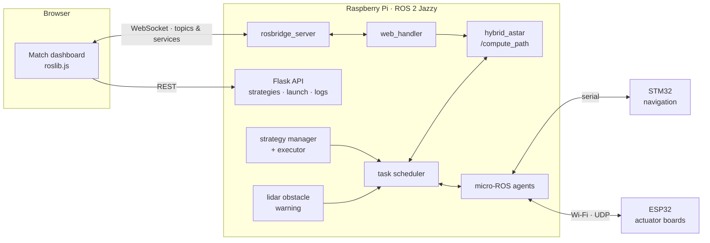

<div align="center">


<br />

**Embedded systems engineering student at INSAT, Tunisia.**<br />
I build developer tools, full-stack products, and the software that makes robots move —<br />
from microcontroller firmware to ROS 2 to the editor you debug it in.

<br />

<a href="https://www.linkedin.com/in/amine-bensaid/"></a>
<a href="mailto:mohamedamine.bensaid@insat.ucar.tn"></a>
<a href="./Amine%20Bensaid.pdf"></a>
<a href="https://pypi.org/project/ros2inspector/"></a>

<br /><br />

🥇 **NXP Cup Tunisia — 1st place** &nbsp;·&nbsp; 🌍 **NXP Cup international finalist** &nbsp;·&nbsp; 🤖 **Eurobot 2026 — 1st in Tunisia, Top 5 worldwide**

</div>

## Right now

- 🪐 Maintaining **[ROS 2 Inspector](https://github.com/aminebensaid66/ros2_inspector)** — static architecture analysis for ROS 2, on PyPI, with a [VS Code extension](https://github.com/aminebensaid66/ros2_inspector_vscode).
- 🎬 Building **[MotionDeck](https://github.com/aminebensaid66/MotionDeck)** — an MCP server that lets Claude and Codex produce animated presentations and export them to HTML, PDF, or video.
- 🦾 Building the **[ROS 2 stack](https://github.com/Eurobot-2026-Aerobotix/ROS2-WS-EURO)** and **[rosbridge dashboard](https://github.com/Eurobot-2026-Aerobotix/Eurobot_Dashboard)** for Aerobotix INSAT's Eurobot robot — path planning, strategy, and micro-ROS.
- 💼 Open to **internships and software engineering roles** in developer tooling, full-stack systems, robotics, and embedded software.

## Featured open source

<table>
<tr>
<td width="50%" valign="top">

### 🪐 ROS 2 Inspector

<sup>CREATOR & MAINTAINER · PYTHON · PYPI</sup>

Understand a ROS 2 workspace **without building or running it**. The CLI parses Python, C++, interface, and launch files to discover packages, nodes, deployments, topics, services, and actions, then renders an evidence-backed architecture graph (Mermaid, DOT, interactive HTML) and enforces architecture policies in CI.

```bash
pipx install ros2inspector
ros2inspector graph comms --format mermaid
```

`Python` `Tree-sitter` `NetworkX` `Typer` `Pytest`

[**Repository ↗**](https://github.com/aminebensaid66/ros2_inspector) &nbsp; [Docs ↗](https://ros2-inspector-theta.vercel.app/) &nbsp; [PyPI ↗](https://pypi.org/project/ros2inspector/)

</td>
<td width="50%" valign="top">

### 🧭 ROS 2 Inspector for VS Code

<sup>CREATOR · TYPESCRIPT · VS CODE API</sup>

The same architecture model, inside the editor: a relationship-aware explorer, an interactive zoomable graph with filters and 1/2-hop focus, audit findings and policy violations in the Problems panel, and jump-to-source navigation.

Static by design — no ROS installation, no DDS, no workspace code executed.

`TypeScript` `VS Code API` `Webviews`

[**Repository ↗**](https://github.com/aminebensaid66/ros2_inspector_vscode)

</td>
</tr>
<tr>
<td width="50%" valign="top">

### 🎬 MotionDeck

<sup>CREATOR · TYPESCRIPT · MCP</sup>

An MCP server for Claude, Codex, and any MCP client that turns a prompt into a **designed, animated slide deck**. The AI sends data; the server draws charts, stats, timelines, and diagrams with six design presets, reports layout problems after every edit, and exports to offline HTML, PDF, MP4, WebM, or GIF.

`TypeScript` `MCP SDK` `reveal.js` `Puppeteer` `ffmpeg` `Zod`

[**Repository ↗**](https://github.com/aminebensaid66/MotionDeck)

</td>
<td width="50%" valign="top">

### 🧠 OR Solver

<sup>AI + OPTIMIZATION · FULL-STACK</sup>

Describe a linear program in **English or French** and get an optimal plan with a plain-language explanation. Gemini only translates intent into a validated model — a deterministic PuLP solver does the math.

**Prompt** → **Gemini parser** → **NestJS API** → **FastAPI + PuLP** → **Explained result**

`React` `NestJS` `FastAPI` `PuLP` `Gemini` `Docker`

[**Repository ↗**](https://github.com/aminebensaid66/Linear_Program_Project)

</td>
</tr>
</table>

## 🦾 Eurobot 2026 — ROS 2 robot stack

<sup>AEROBOTIX INSAT · ROS 2 & EMBEDDED DEVELOPER</sup>

🥇 **1st in Tunisia** &nbsp;·&nbsp; 🥈 **Accumulation phase** &nbsp;·&nbsp; 🌍 **Top 5 worldwide** &nbsp;·&nbsp; [Team organization ↗](https://github.com/Eurobot-2026-Aerobotix) &nbsp;·&nbsp; [Robot demo ↗](https://www.youtube.com/watch?v=EC6gGIbOj7o&list=PLNhKoU2ZKSAGotMFKrfqBCY1hgt4LfQE8)

An autonomous competition robot whose brain is a Raspberry Pi running **ROS 2 Jazzy**. It plans paths around live obstacles, runs match strategies, and drives an STM32 and several ESP32 boards through micro-ROS — all monitored and controlled from a browser over **rosbridge**.



<table>
<tr>
<td width="50%" valign="top">

### 🧠 ROS 2 workspace

<sup>TOP CONTRIBUTOR · PYTHON · RCLPY</sup>

The robot's onboard software, about 23k lines of Python across five packages.

- **Hybrid A\* planner** (main author): orientation-aware paths, footprint collision checks, smoothing, and a live obstacle database updated over topics and services
- **Strategy & task scheduling**: YAML-defined match strategies, pick/put-down sequencing, retreats, safety obstacles, and return-home timing
- **Custom interfaces**: `ComputePath`, `UpdateMap`, `PutDown`, `ObstacleArray`, `ActiveBatches`, and more
- Concurrency with `MultiThreadedExecutor` and reentrant callback groups, explicit QoS profiles, tf2 transforms, and RViz visualization

`ROS 2 Jazzy` `rclpy` `Custom msgs/srvs` `tf2` `RViz` `micro-ROS`

[**ROS2-WS-EURO ↗**](https://github.com/Eurobot-2026-Aerobotix/ROS2-WS-EURO)

</td>
<td width="50%" valign="top">

### 🖥️ Match dashboard (rosbridge)

<sup>CORE DEVELOPER · ROSLIB.JS · FLASK</sup>

A web control room served from the robot, used from any laptop on the team network.

- **Live robot view over rosbridge**: subscribes to pose, planned path, `MarkerArray`, and obstacle topics; publishes start/goal/enemy poses; calls `std_srvs/Trigger` services
- **`web_handler` bridge node**: converts browser commands (mm → m, degrees → quaternions) into planner requests and returns results
- **Match control**: strategy editor and selection, start/stop, PAMI tests, micro-ROS agent restart, and live log streaming
- Rotated/mirrored real-table map, full-game path preview, and auto-reconnect, all run as **systemd** services on the Pi

`rosbridge` `roslib.js` `JavaScript` `Flask` `systemd` `Raspberry Pi`

[**Eurobot_Dashboard ↗**](https://github.com/Eurobot-2026-Aerobotix/Eurobot_Dashboard)

</td>
</tr>
</table>

<details>
<summary><strong>Firmware & other Eurobot repos I contributed to</strong></summary>
<br />

| Repo | My contribution |
|---|---|
| [Navigation_MicroROS_2026](https://github.com/Eurobot-2026-Aerobotix/Navigation_MicroROS_2026) | STM32 micro-ROS: pose topic, services, automatic reconnect when the agent restarts |
| [System_code_ESP32_back](https://github.com/Eurobot-2026-Aerobotix/System_code_ESP32_back) / [front](https://github.com/Eurobot-2026-Aerobotix/System_code_ESP32_front) / [pneumatic](https://github.com/Eurobot-2026-Aerobotix/System_Code_ESP32_pneumatic) | Agent reconnection, reliable QoS, faster DDS discovery, status and debug topics, memory fix |
| [PAMI_ESP32_code](https://github.com/Eurobot-2026-Aerobotix/PAMI_ESP32_code) | Status service, motion commands, and beacon communication for the small PAMI robots |
| [LIDAR_EUROBOT](https://github.com/Eurobot-2026-Aerobotix/LIDAR_EUROBOT) | Obstacle-warning messages, remote visualization, Raspberry Pi integration |

</details>

## Robotics & embedded

<table>
<tr>
<td width="50%" valign="top">

### 🏎️ NXP Cup Autonomous Car

<sup>EMBEDDED & CONTROL DEVELOPER</sup>

Real-time lane following on a Teensy 4: Pixy2 vision → steering error → PID correction, with encoder-based speed control and serial telemetry for tuning. Backed by an [ESP32 WebSocket test rig](https://github.com/aminebensaid66/WebSockets-ESP32) for driving the car without the camera pipeline.

`Embedded C++` `PlatformIO` `PID` `Teensy 4` `Pixy2` `ESP32`

🥇 **1st in Tunisia** &nbsp;·&nbsp; International finalist, Netherlands 2025

[**Repository ↗**](https://github.com/aminebensaid66/NXP-CUP-FINALS)

</td>
<td width="50%" valign="top">

### 🌊 Orange IoT Platform

<sup>ORANGE DIGITAL CENTER · IoT SOFTWARE ENGINEER INTERN</sup>

Monitoring and regulation of microalgae pools: embedded acquisition, closed-loop actuation, AWS IoT telemetry, remote commands, and web plus touchscreen interfaces.

`Embedded C` `Python` `Flask` `AWS IoT Core` `MQTT`


</td>
</tr>
</table>

## Full-stack products

<table>
<tr>
<td width="50%" valign="top">

### 🧶 TRI-UP Platform

<sup>PRIVATE ORGANIZATION PROJECT · FULL-STACK DEVELOPER</sup>

E-learning, production matching, and logistics for artisan associations. I worked on matching, concurrent order flows, secure media delivery, authentication, performance, UI reliability, and automated testing.

`Next.js` `NestJS` `PostgreSQL` `Prisma` `Redis` `MinIO/R2`

</td>
<td width="50%" valign="top">

### ✅ Task Manager

<sup>FULL-STACK · PRODUCTION-ORIENTED</sup>

Team task management with admin/employee roles enforced server-side, HttpOnly JWT auth, comments and activity history, filters and dashboards, migrations, health checks, Docker Compose deployment, and CI with unit and E2E tests.

`React` `NestJS` `Prisma` `PostgreSQL` `Docker` `GitHub Actions`

[**Repository ↗**](https://github.com/aminebensaid66/Task-Manager)

</td>
</tr>
</table>

<details>
<summary><strong>More things I built</strong></summary>
<br />

| Project | What it is |
|---|---|
| [Line-Follower Robot](https://github.com/aminebensaid66/Line_Follower_Robocup_Ensi_2024) | Five-sensor PID line follower for ENSI RoboCup 2024 (Arduino C++) |
| [ESP32 Firebase IoT Node](https://github.com/aminebensaid66/-ESP32-Firebase-IoT-Node) | ESP32/FreeRTOS node publishing timestamped DHT11 telemetry to Firebase over TLS |
| [Eurobot Dashboard](https://github.com/Eurobot-2026-Aerobotix/Eurobot_Dashboard) | Web control dashboard served from the robot's Raspberry Pi |
| [ChatGPT Prompt Runner](https://github.com/aminebensaid66/chatGPT.com-Automation-GUI) | macOS desktop app (Electron + Next.js) for organizing reusable prompt workflows |
| [ViT for antenna inverse design](https://github.com/aminebensaid66/VIT-Generative) | PyTorch Vision Transformer predicting circular antenna-array configurations from radiation specs |
| [Robot path simulator](https://github.com/aminebensaid66/Path-Simulator-Robot-Java-Project) | Java OOP prototype: robots, obstacles, charging points, and pathfinding |
| [Codeforces solutions](https://github.com/aminebensaid66/codeforces-problems) | C++ competitive programming practice |

</details>

## Toolkit

<div align="center">


</div>

<br />

<table>
<tr>
<td width="33%" valign="top">

**Build**

Python · C/C++ · TypeScript<br />
React · Next.js · NestJS · FastAPI<br />
Flutter · Electron

</td>
<td width="33%" valign="top">

**Connect**

ROS 2 · rosbridge · micro-ROS · tf2<br />
MQTT · MCP · REST · WebSockets<br />
BLE · Serial · UDP · CAN

</td>
<td width="33%" valign="top">

**Operate**

PostgreSQL · Redis · Prisma<br />
Docker · Linux · systemd<br />
GitHub Actions · AWS IoT

</td>
</tr>
</table>

---

<div align="center">

### Have an ambitious system to build?

Whether it is a robot, a developer tool, or a product with real users — I'd like to hear about it.

[](https://www.linkedin.com/in/amine-bensaid/)

</div>
